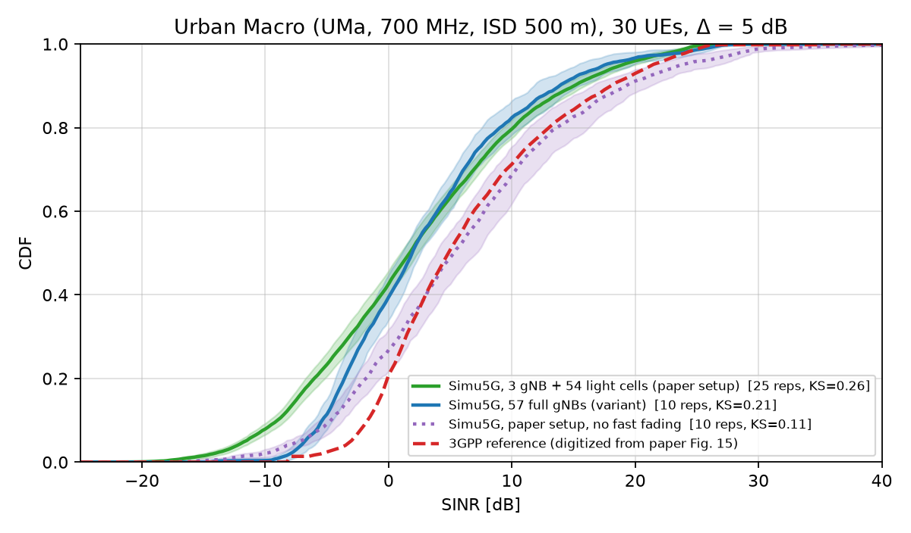
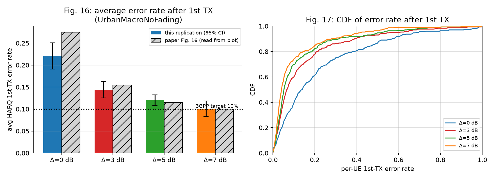

# Replicating the Simu5G paper's validation (Nardini et al., IEEE Access 2020)

End-to-end replication of **Sec. IV-E** of *"Simu5G – An OMNeT++ Library for End-to-End Performance
Evaluation of 5G Networks"*: the 3GPP Urban-Macro calibration scenario (Fig. 14), the SINR CDF against the
3GPP reference (Fig. 15) and the receiver-sensitivity calibration Δ (Figs. 16-17).

Everything lives in this folder and is isolated from the rest of the machine: the existing OMNeT++ 6.4.0 and
the already-built INET 4.7.0 are **reused read-only**; Simu5G v1.7.0 is built locally in `./simu5g` (not
committed, see `setup.sh`), with a small patch (`patches/`).

## TL;DR - how close is the replication?

| Paper result | Replicated? |
|---|---|
| Fig. 14 - 57 cells (19 sites x 3), ISD 500 m, 3 full-stack central cells + 54 light cells, 30 UEs | yes (`figures/fig14_layout.png`) |
| Fig. 16/17 - 1st-TX error rate vs Δ (0/3/5/7 dB), ~10 % at Δ = 5-7 dB | **yes, when fast fading is off** (mean error 0.22 / 0.14 / 0.12 / 0.10 vs paper 0.275 / 0.155 / 0.115 / 0.10) |
| Fig. 15 - SINR CDF overlaps the 3GPP reference | **close, when fast fading is off** (KS distance 0.11, median 5.3 dB vs 4.8 dB reference) |
| Same results with fast fading enabled (Table 2 says "Fading + shadowing: enabled") | **no** - with Simu5G v1.7.0 fading, the error rates are 0.61 / 0.52 / 0.47 / 0.40 and the SINR CDF is ~3 dB left of the reference (KS 0.26) |

So the paper's numbers are reproduced quantitatively only for the configuration without fast fading; with
fading enabled the current Simu5G release does not reproduce them. The likely reasons are listed under
*Caveats*; I did not find a parameter combination that fixes this without disabling fading.




## Stages and validation

1. **Environment** - Simu5G v1.7.0 built (release mode) against the existing OMNeT++ 6.4.0 / INET 4.7.0.
   Validated by running the bundled `simulations/NR/standalone` example to completion.
2. **Baseline scenario** (`validation/baseline.ini`) - 1 gNB, UPF, server, 5 static UEs at 50-450 m, DL CBR
   2 Mbit/s. Validated: 100 % of the offered load delivered, no loss, SINR falls and delay rises with distance
   (`validation/figures/stage2_baseline.png`).
3. **Paper validation** (`validation/omnetpp.ini`, `full.ini`) - the scenario of Table 2:

   | Parameter | Value used |
   |---|---|
   | gNBs | 57 = 19 sites x 3 sectors (boresight 30/150/270 deg), ISD 500 m; 3 central ones full stack, 54 light cells (`ExtCell`, 100 % load, all 50 PRBs) |
   | UEs | 30, uniform in the central site hexagon, 3 km/h linear mobility, 80 % indoor (TR 36.873 O2I penetration) |
   | Carrier / bandwidth | 700 MHz FDD, 10 MHz = 50 PRB, numerology 0 |
   | Propagation | TR 36.873 3D-UMa, shadowing on, Jakes fading (except in `UrbanMacroNoFading`) |
   | Tx power / antennas / noise figure | 46 dBm, 8 dBi gNB, 0 dBi UE, 5 dB / 7 dB |
   | Traffic | DL CBR 240 kbit/s per UE (60 B / 2 ms) |
   | Δ | 0, 3, 5, 7 dB (`binder.blerShift`) |
   | Repetitions | 50 (Δ = 0), 25 (Δ = 3, 5, 7), 10 per Δ without fading, 10 for the 57-gNB variant; 10 s each |

   Configurations: `UrbanMacro` (paper setup), `UrbanMacroNoFading` (same, fading off), `UrbanMacroFull`
   (variant: all 57 cells are full gNBs, 54 saturating "load" UEs, UEs may attach to any cell).

### SINR quantiles [dB] (Δ = 5 dB; `validation/results/sinr_quantiles.csv`)

| quantile | 3GPP ref. (digitized) | UrbanMacro | NoFading | Full (57 gNB) |
|---|---|---|---|---|
| 5 % | -3.1 | -11.6 | -7.3 | -6.8 |
| 25 % | 0.7 | -4.6 | -0.7 | -2.8 |
| 50 % | 4.8 | 1.7 | 5.3 | 1.9 |
| 75 % | 11.1 | 8.3 | 11.8 | 7.3 |
| 95 % | 21.4 | 18.9 | 23.7 | 17.5 |
| KS distance | - | 0.26 | 0.11 | 0.21 |

### First-transmission error rate (mean over UEs, 95 % CI over repetitions)

| Δ [dB] | paper (read from Fig. 16) | NoFading | UrbanMacro (fading) |
|---|---|---|---|
| 0 | 0.275 | 0.221 ± 0.030 | 0.612 ± 0.013 |
| 3 | 0.155 | 0.144 ± 0.019 | 0.518 ± 0.018 |
| 5 | 0.115 | 0.120 ± 0.012 | 0.465 ± 0.017 |
| 7 | 0.100 | 0.100 ± 0.018 | 0.395 ± 0.017 |

## Independent cross-checks
* `validation/scripts/analytic_check.py` - a stand-alone Monte-Carlo of the same geometry (TR 36.873 path loss,
  sector pattern, shadowing, O2I). It agrees with the simulator within ~2 dB, and shows that the reference
  curve corresponds to attaching each UE to the best of **all 57** cells (5 % quantile -3.6 dB vs -11 dB when
  restricted to the 3 central cells).
* Ablations on the SINR chain (fading / shadowing / LOS / indoor off) were used to locate the discrepancy.

## Caveats and deviations (please read)
* **The "3GPP reference" is digitized** from the raster Fig. 15 of the paper
  (`validation/reference/`); the original data (RP-180524 attachment) is not publicly available. The Fig. 16
  bar heights were also read off the plot (+-0.01).
* **Fewer repetitions** than the paper's 50 for Δ = 3/5/7 and for the extra configurations, to keep the laptop
  cool; confidence intervals are reported accordingly. Simulated time 10 s (UEs move < 10 m).
* **Simu5G v1.7.0, not the 2020 version**, and INET 4.7 (the project asks for 4.5+). Four changes were made to the
  library (`patches/simu5g-v1.7.0-omnetpp64-extcell.patch`, build-time only, not part of the paper):
  1. `receiveSignal(... long ...)` -> `intval_t` (OMNeT++ 6.4 on arm64 macOS);
  2. **bug fix** `ExtCell` with `FULL_ALLOC` never occupied any RB (`vector::resize` instead of `assign`), so
     light cells produced no interference;
  3. new `indoorFraction` parameter: the 80/20 indoor/outdoor split must be applied identically on the gNB-side
     (CQI) and UE-side (reception) channel models and on the interference links; with per-model `insideBuilding`
     the CQI ignored the penetration loss and about 90 % of first transmissions failed;
  4. optional `deterministicLos` (shared LOS state on both sides). Not used in the final runs (`dynamicLos=false`,
     i.e. NLOS-only formula floored by the LOS one), because the LOS probability made the upper SINR tail
     too heavy compared with the reference.
* Light cells use the TR 36.814 NLOS path loss without shadowing (hard-coded in Simu5G); there is no
  wrap-around (the paper does not mention one).
* The SINR statistic is the dB-average of per-RB SINR (as emitted by Simu5G), so it includes the ~2.5 dB
  mean-log bias of fast fading; this is one reason the fading configuration sits left of the reference.
* Why fading breaks the Δ calibration here: error probability is computed per RB with a single CQI per TB, so
  per-RB fades produce many first-transmission errors that Δ <= 7 dB does not absorb. The 2020 release the
  authors used may differ; I could not verify that.
* Not replicated: Section V (MEC and C-V2X case studies) - out of scope of the request.

## Reproduce
```bash
./setup.sh                                    # clone+patch+build Simu5G, create the python venv
source env.sh                                 # OMNeT++ / INET paths (override OMNETPP_ROOT, INET_ROOT)
cd validation
scripts/run_baseline.sh                       # stage 2
JOBS=4 scripts/run_everything.sh              # stage 3, ~2-3 h, 4 low-priority jobs
for c in UrbanMacro UrbanMacroNoFading UrbanMacroFull; do ../.venv/bin/python scripts/extract.py $c; done
../.venv/bin/python scripts/plot_sinr.py 5; ../.venv/bin/python scripts/plot_error.py UrbanMacroNoFading
```
Note: OMNeT++'s link post-processing fails on paths containing spaces; if this folder lives under such a path,
create a space-free symlink (e.g. `ln -s "<folder>" ~/Acads/s5g-work`), `env.sh` picks it up automatically.
Raw `.sca/.vec` results (~1 GB) are not committed; the per-UE statistics and compressed SINR samples are in
`validation/results/extracted/`.
